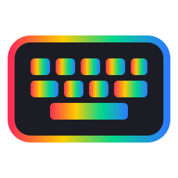
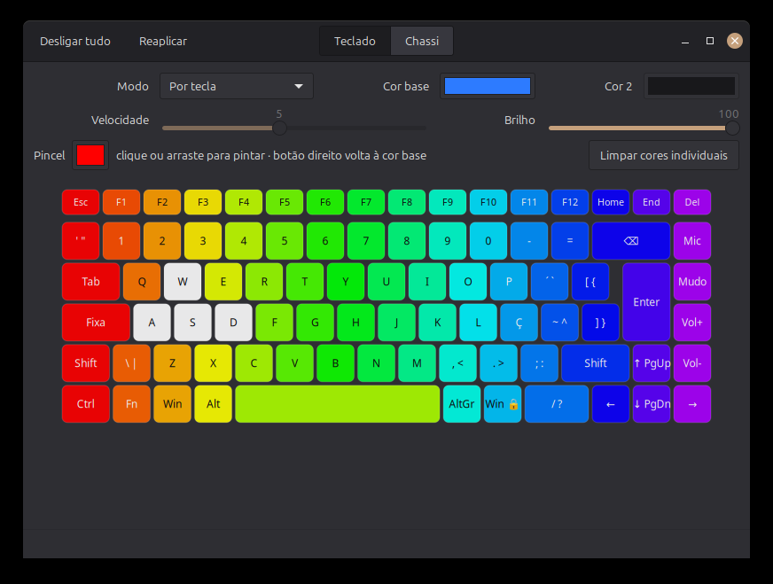
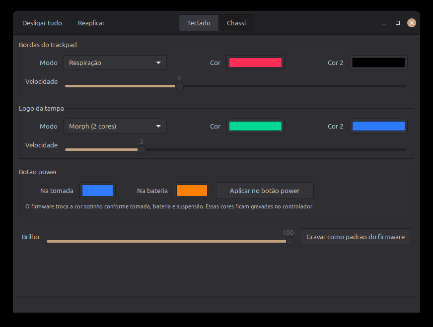

<p align="center">
  
</p>

<h1 align="center">AW Light</h1>

<p align="center">
  Iluminação RGB do <strong>Alienware m16 R2</strong> no Linux: teclado por tecla, bordas do
  trackpad, logo da tampa e botão power.
</p>

<p align="center">
  <a href="https://github.com/guilhermefeitosa66/awlight/releases/latest"></a>
  <a href="LICENSE"></a>
  
</p>

O Alienware Command Center só existe para Windows. O AW Light faz o mesmo controle de luzes no
Linux, falando direto com os controladores USB do notebook pelo `/dev/hidraw`. Não precisa de
driver de kernel nem de rodar como root.





<!-- Fotos do notebook com as luzes acesas entram aqui (docs/fotos/). -->

## Recursos

- **Teclado por tecla (ABNT2)**: clique ou arraste para pintar as teclas, botão direito volta à
  cor base.
- **Efeitos de hardware no teclado**: estático, respiração, onda, onda dupla, pulso, morph,
  bounce, laser e arco-íris, com velocidade e brilho.
- **Trackpad e logo**: cor fixa, pulso, morph entre duas cores, respiração, espectro ou desligado.
- **Botão power**: uma cor na tomada e outra na bateria. O firmware alterna sozinho, inclusive
  na suspensão e com bateria crítica.
- **Gravar no firmware**: trackpad e logo já acendem com as suas cores desde o boot.
- **Serviço de usuário**: reaplica as cores no login e ao voltar da suspensão.
- **Linha de comando** completa, boa para scripts e atalhos de teclado.

## Hardware suportado

| Luz | Controlador | USB |
|---|---|---|
| Teclado RGB por tecla | DELL Technologies Keyboard (Darfon) | `0d62:d2b1` |
| Bordas do trackpad (zona 0), logo da tampa (zona 2), botão power (zona 4) | Alienware AW-ELC | `187c:0551` |

Testado num m16 R2 com teclado ABNT2 (Linux Mint 22.3, kernel 7.0, firmware do ELC 2.1.18).
Para conferir se o seu notebook tem os mesmos controladores:

```sh
lsusb | grep -Ei '187c:0551|0d62:d2b1'
```

Outros modelos com AW-ELC podem funcionar em parte, mas as zonas e o mapa de teclas são
específicos do m16 R2.

## Instalação

### Pacote .deb (Linux Mint, Ubuntu, Debian e derivados)

Baixe o `.deb` da [última release](https://github.com/guilhermefeitosa66/awlight/releases/latest) e
instale:

```sh
sudo apt install ./awlight_0.1.0_all.deb
```

O pacote instala a regra udev (acesso aos LEDs sem root), o atalho **AW Light** no menu e o
serviço `awlight.service` para todos os usuários. Para ativar o serviço sem sair da sessão:

```sh
systemctl --user start awlight.service
```

### AppImage

O AppImage usa o Python 3 e o GTK 3 do sistema, que já vêm na maioria dos desktops. Se faltar
algo: `sudo apt install python3-gi gir1.2-gtk-3.0`.

```sh
chmod +x AWLight-0.1.0-x86_64.AppImage
./AWLight-0.1.0-x86_64.AppImage                 # abre a interface
./AWLight-0.1.0-x86_64.AppImage udev-rule | sudo tee /etc/udev/rules.d/70-awlight.rules
sudo udevadm control --reload-rules && sudo udevadm trigger --subsystem-match=hidraw
```

O AppImage não instala o serviço de login. Se quiser as cores reaplicadas automaticamente, use o
`.deb` ou a instalação a partir do código.

### A partir do código

```sh
git clone https://github.com/guilhermefeitosa66/awlight.git
cd awlight
./install.sh       # mostra o que vai fazer e pede confirmação
```

Instala em `~/.local` para o seu usuário. Só a regra udev usa `sudo`. Para remover:
`./uninstall.sh`.

## Uso

Abra **AW Light** no menu ou rode `awlight gui`.

- **Teclado**: no modo *Por tecla*, escolha a cor do pincel e pinte as teclas. Nos outros modos o
  efeito roda no próprio teclado.
- **Chassi**: trackpad e logo mudam na hora. O botão power só é gravado ao clicar em
  *Aplicar no botão power*.

Linha de comando:

```sh
awlight status                          # controladores encontrados
awlight kb color 00ff88                 # teclado inteiro numa cor
awlight kb key w=ff0000 a=ff0000 s=ff0000 d=ff0000
awlight kb effect rainbow --speed 7
awlight kb effect morph ff0000 0000ff
awlight kb keys                         # nomes das teclas
awlight zone logo color ffffff
awlight zone all breathing ff0000 --speed 4
awlight power --ac 0050ff --battery ff8000
awlight brightness --keyboard 60 --chassis 100
awlight off                             # apaga tudo (a configuração continua salva)
awlight apply                           # reaplica a configuração salva
awlight save                            # grava chassi e botão power no firmware
```

A configuração fica em `~/.config/awlight/config.json`.

## Como funciona

- **AW-ELC (API v4)**: pacotes de 34 bytes enviados como output report e respondidos por input
  report. As cores rodam como uma animação volátil (slot `0xFFFF`) ou gravada (slot `0x61`,
  padrão do boot). O botão power usa os slots de estado de energia `0x5B` a `0x60`; por isso ele
  não entra na animação comum, senão o firmware fica piscando entre as duas.
- **Teclado Darfon (API v5)**: feature reports de 64 bytes com report ID `0xCC`. Cada pacote
  leva até 15 teclas (`ID+1, R, G, B`). Os IDs válidos vão de 0 a 135; acima disso o firmware
  reaproveita LEDs da primeira fileira.

```
awlight/
├── hidraw.py    acesso ao /dev/hidraw por ioctl
├── elc.py       protocolo do AW-ELC (chassi e botão power)
├── keyboard.py  protocolo do teclado Darfon
├── layout.py    mapa físico ABNT2 e zonas
├── control.py   configuração -> comandos (usado pela CLI, GUI e daemon)
├── cli.py       linha de comando e daemon
└── gui.py       interface GTK 3
```

O mapa ABNT2 foi montado acendendo os LEDs um a um no teclado real. Se alguma tecla não
acender no seu, `awlight kb identify` acende um ID por vez para você achar o certo e ajustar
`awlight/layout.py`.

## Cuidados

- O botão power e o *Gravar como padrão* escrevem na memória flash do controlador, como o AWCC
  faz no Windows. O programa só regrava o botão power quando as cores mudam.
- Não use junto com outro programa de RGB (OpenRGB etc.) controlando os mesmos dispositivos.

## Gerar os pacotes

```sh
./packaging/build-deb.sh        # dist/awlight_<versão>_all.deb
./packaging/build-appimage.sh   # dist/AWLight-<versão>-x86_64.AppImage (baixa o appimagetool)
```

## Créditos e licença

Licenciado sob a [Apache License 2.0](LICENSE). O protocolo foi implementado a partir do que
documentam o [alienfx-tools](https://github.com/T-Troll/alienfx-tools) (MIT) e o
[OpenRGB](https://gitlab.com/CalcProgrammer1/OpenRGB), e conferido no hardware. Veja o
[NOTICE](NOTICE).

Projeto independente, sem relação com a Dell. Alienware é marca registrada da Dell Inc.
